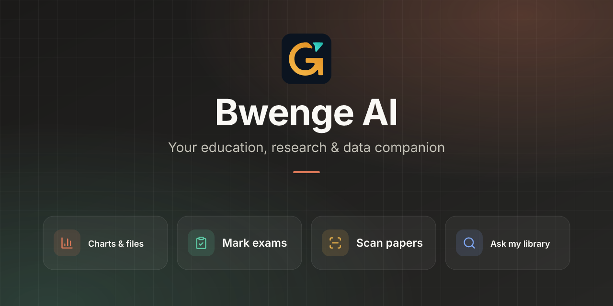

<div align="center">



**Scan, mark and understand data, from one chat, on the web and in Telegram.**

[Open Bwenge](https://www.bwenge.space) · [Telegram bot](https://t.me/Bwengebot) · [Documentation](docs/)

*Submission to the NISR 2026 Big Data Hackathon*

</div>

---

## The problem

Teachers in Rwanda spend evenings marking paper scripts by hand, and schools, students and researchers collect
survey data that is rarely analysed properly. Bwenge turns both into evidence: marked scripts with results tables,
and well-designed surveys whose answers come back as clean, analysis-ready data with correct statistics.

This supports evidence-based decision making in education (NST2 human-capital priority, Vision 2050).

## What it does

| | |
|---|---|
| **Mark exams** | Attach scripts (phone photos, PDF, Word or a ZIP) and say "mark these". Every script comes back corrected in red pen as a PDF, with an Excel results file. The teacher reviews and adjusts marks before releasing them. |
| **Scan papers** | Phone-camera scanner with edge detection, on the web and as a Telegram Mini App. |
| **Forms and surveys** | Describe a survey in plain words. Bwenge builds it, checks it (readiness score, consent, wording, branching), publishes it and analyses the responses. |
| **Data analysis** | Upload CSV or Excel files, or ask about NISR statistics. Charts, tables, HTML reports and Excel files are made in the chat. All numbers are computed by code, never estimated by the AI. |
| **Learning** | Socratic tutor, roleplay practice, adaptive practice questions and anonymous class overviews for teachers. |

## Data

| Source | How it is used |
|---|---|
| **NISR public datasets and reports** ([microdata portal](https://microdata.statistics.gov.rw/index.php/catalog), [statistics.gov.rw](https://www.statistics.gov.rw)) | Indexed from `data/nisr/` and cited by source, period and unit when answering statistics questions. See [`data/nisr/README.md`](data/nisr/README.md) for how a dataset is added and checked. |
| **Survey responses collected with Bwenge forms** | Stored with variable names, measurement levels and the form version they answered. Exported as CSV or Excel with a codebook. |
| **Exam scripts uploaded by teachers** | Private to the teacher. Marks are kept with the reason for each mark, and nothing is released without the teacher. |

## What it communicates

- **For a class:** each student's marks per question, why marks were lost, and the class results in Excel.
- **For a survey:** response rates per question, distributions, averages, and group comparisons with the method and the p-value. It also says when a test is not appropriate for the data.
- **For a question about Rwanda's statistics:** the figure, its source, period and unit.

## How to use it

1. Open [www.bwenge.space](https://www.bwenge.space) and sign in with Google or email, or open the Telegram bot.
2. Type what you need in the chat, for example:
   - *"Mark these"*, with the scripts attached.
   - *"Create a survey on student satisfaction with campus services"*.
   - *"Analyse the responses to my survey and give me the Excel file"*.
   - *"Show unemployment by district as a chart"*.
3. Live progress steps show what Bwenge is doing. Files arrive as cards that you can open or download.
4. On a form or a marked exam, the **Ask Bwenge** button keeps the chat beside your work.

## Run it

Requirements: Node.js 20 or later.

```bash
npm install
cp .env.example .env   # add an AI provider key and a session secret
npm run dev            # http://localhost:3000
```

```bash
npm test               # test suite
npm run build          # production build (dist/)
npm run nisr:index     # rebuild the NISR data index after adding a dataset
```

Production uses PostgreSQL (`npx prisma migrate deploy`). Deployment, billing, Telegram and the AI architecture
are documented in [`docs/`](docs/).

## Repository

```
server/            API, AI tools, marking, forms, statistics, Telegram bot
src/               web app (React)
data/nisr/         NISR datasets, manifest and index
prisma/            database schema and migrations
docs/              documentation
tests/             automated tests
```

## Team

Built in Rwanda for the NISR 2026 Big Data Hackathon. This submission is the team's own work. All external
libraries and data sources are acknowledged above and in `package.json`.
